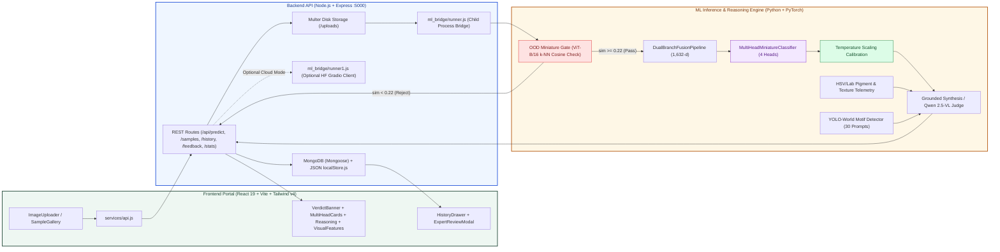
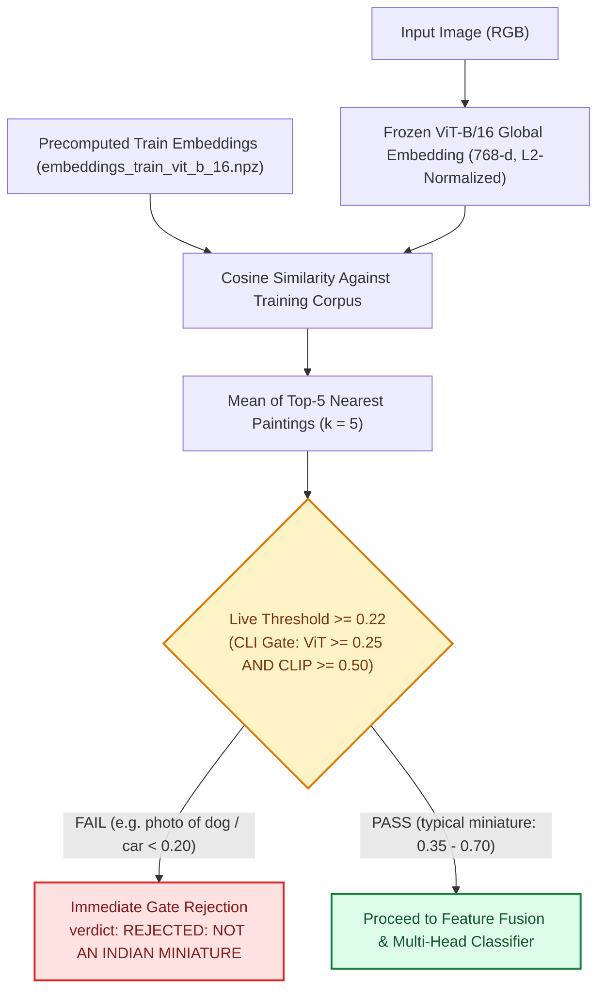
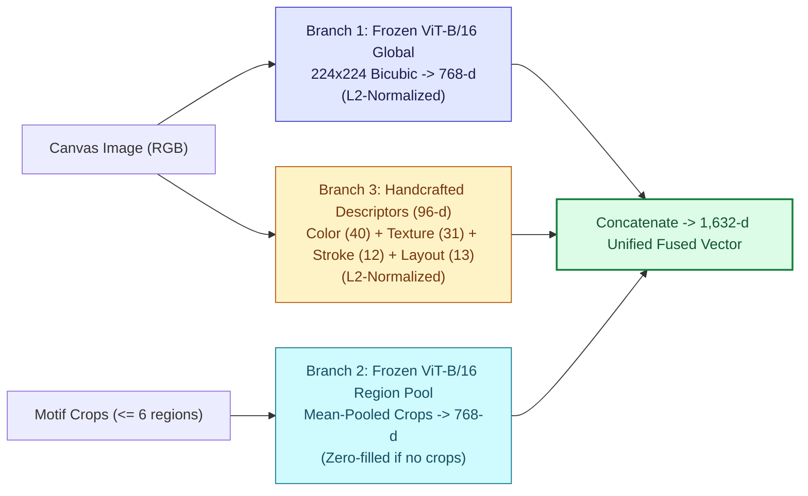
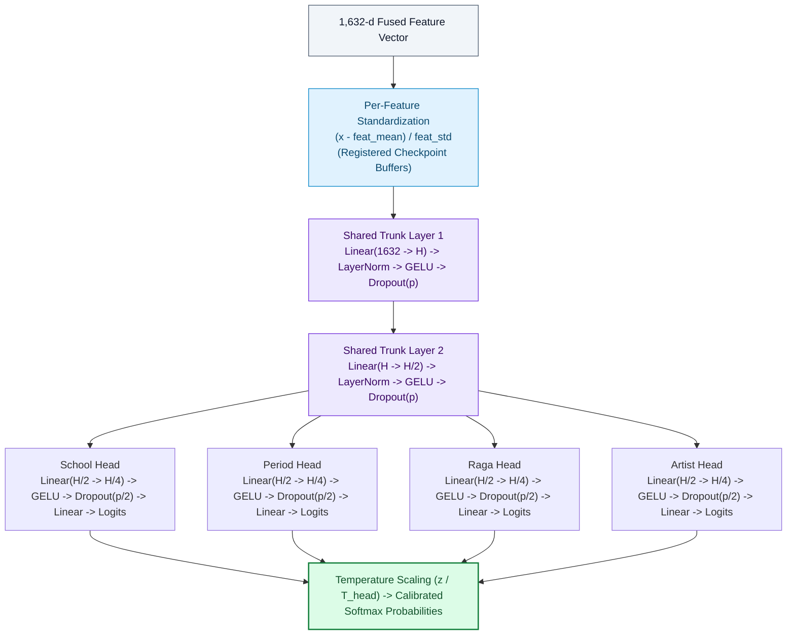
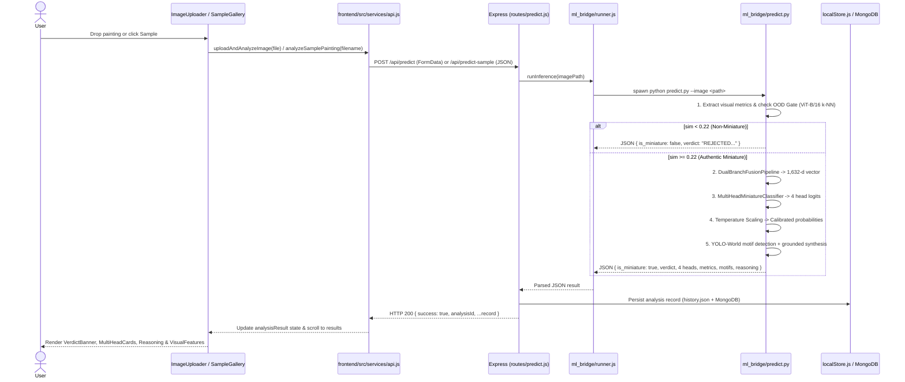

<div align="center">

# Mughal-Auth AI
### Multi-Head Vision Transformer, Dual-Branch Feature Fusion & Multimodal VLM Authentication Platform for Indian Miniature Paintings


*B.Tech Project — Autonomous Miniature Art Connoisseurship by **Anushesh**, **Snigdha Ghosh**, and **Arka Ghosh***

</div>

---

## Table of Contents

1. [Executive Overview](#1-executive-overview)
2. [System Architecture at a Glance](#2-system-architecture-at-a-glance)
3. [Deep Dive: How the Machine Learning Model Works & Predicts](#3-deep-dive-how-the-machine-learning-model-works--predicts)
   - [3.1 Dataset Curation & Leak-Free Manuscript Splitting](#31-dataset-curation--leak-free-manuscript-splitting)
   - [3.2 Step 1 — Out-of-Distribution (OOD) Miniature Gate](#32-step-1--out-of-distribution-ood-miniature-gate)
   - [3.3 Step 2 — High-Resolution Preprocessing & Sliding Windows](#33-step-2--high-resolution-preprocessing--sliding-windows)
   - [3.4 Step 3 — Open-Vocabulary Motif Detection (YOLO-World)](#34-step-3--open-vocabulary-motif-detection-yolo-world)
   - [3.5 Step 4 — Dual-Branch Feature Fusion (1,632-D Vector)](#35-step-4--dual-branch-feature-fusion-1632-d-vector)
   - [3.6 Step 5 — Multi-Head Neural Classifier Architecture](#36-step-5--multi-head-neural-classifier-architecture)
   - [3.7 Step 6 — Post-Hoc Temperature Scaling Calibration](#37-step-6--post-hoc-temperature-scaling-calibration)
   - [3.8 Step 7 — Visual Telemetry, Multimodal VLM Judge & Active Learning](#38-step-7--visual-telemetry-multimodal-vlm-judge--active-learning)
   - [3.9 Quantitative Benchmark Performance](#39-quantitative-benchmark-performance)
4. [Backend Architecture & Model Integration (`backend/`)](#4-backend-architecture--model-integration-backend)
   - [4.1 Server Lifecycle & Middleware (`server.js`)](#41-server-lifecycle--middleware-serverjs)
   - [4.2 The Node-to-Python ML Bridge (`runner.js` & `ml_bridge/`)](#42-the-node-to-python-ml-bridge-runnerjs--ml_bridge)
   - [4.3 REST API Routes & Data Persistence](#43-rest-api-routes--data-persistence)
5. [Frontend Architecture & File-by-File Breakdown (`frontend/`)](#5-frontend-architecture--file-by-file-breakdown-frontend)
   - [5.1 Build, Proxy & Deployment Configuration](#51-build-proxy--deployment-configuration)
   - [5.2 State, Styling & API Service Layer](#52-state-styling--api-service-layer)
   - [5.3 Complete Component-by-Component Working](#53-complete-component-by-component-working)
   - [5.4 End-to-End Request & Render Lifecycle](#54-end-to-end-request--render-lifecycle)
6. [Cloud Gradio Space (`mughal-art-classifier/`)](#6-cloud-gradio-space-mughal-art-classifier)
7. [Repository Directory Map](#7-repository-directory-map)
8. [Local Setup & Execution Guide](#8-local-setup--execution-guide)

---

## 1. Executive Overview

**Mughal-Auth AI** is an end-to-end full-stack computer vision and art-historical reasoning platform designed to authenticate **Indian miniature paintings**—distinguishing Imperial **Mughal** atelier works from **Rajasthani** and **Pahari** traditions while predicting historical **Period**, **Ragamala musical mode**, and **Artist attribution**.

Unlike generic image classifiers that blindly downscale canvases to `224x224` and force any uploaded photograph into a miniature label with overconfident softmax scores, this system enforces four domain-critical guarantees:

> [!IMPORTANT]
> 1. **Out-of-Distribution Rejection**: Non-miniature images (modern photographs, portraits, documents, animals) are intercepted by a cosine-similarity distribution gate before classification.
> 2. **Dual-Branch Representation**: Deep semantic embeddings (`ViT-B/16`) are fused with 96 quantitative pigment, texture, stroke, and symmetry descriptors tailored to mineral pigments and *nim-qalam* brushwork.
> 3. **Honest Calibrated Probabilities**: Post-hoc Temperature Scaling aligns predicted confidence percentages with empirical test-set accuracy.
> 4. **Zero Fabricated Fallbacks**: If the Python ML runtime or checkpoint is unavailable, the backend explicitly fails with HTTP `503` rather than returning simulated predictions.

---

## 2. System Architecture at a Glance

The platform operates across three coordinated tiers: a **React 19** presentation portal, an **Express.js** orchestration backend with dual storage, and a **PyTorch / Computer Vision** inference engine.



---

## 3. Deep Dive: How the Machine Learning Model Works & Predicts

The ML architecture lives in `BTP/src/` and is executed in real time by `backend/ml_bridge/predict.py` (locally) or `mughal-art-classifier/app.py` (on Hugging Face Spaces). Every prediction follows a deterministic multi-stage pipeline rather than a black-box single forward pass.

### 3.1 Dataset Curation & Leak-Free Manuscript Splitting

Historical miniature datasets contain multiple folios from the same manuscript or royal album (for example, `ms_cma_tutinama` contains **153 folios**). A standard random `train_test_split` leaks shared border patterns, *wasli* paper aging, and pigment recipes across splits, artificially inflating test scores.

To prevent leakage, `BTP/src/grouped_splitting.py` partitions the **564 curated paintings** across **341 disjoint manuscript/album groups** using multi-objective stratified optimization (`10,000` trials minimizing size deviation while guaranteeing representation across categories, schools, and major imperial periods):

| Split | Paintings | Share | Disjoint Groups | Group Overlap | Primary Role |
| :--- | :---: | :---: | :---: | :---: | :--- |
| **Train** | 395 | 70.04% | 216 | 0% | Model weight training & feature standardization stats |
| **Validation** | 85 | 15.07% | 60 | 0% | Early stopping & post-hoc Temperature Scaling fit |
| **Test (Held-Out)** | 84 | 14.89% | 65 | 0% | Unbiased benchmark evaluation & VLM cross-check |
| **Total Corpus** | **564** | **100%** | **341** | **0%** | 395 Mughal Miniatures · 134 Painting Crops · 35 Ragamalas |

#### "Honest Heads" Target Normalization (`BTP/src/dataset.py`)
Because museum metadata is heavily skewed (~90% Mughal, ~90% Non-Ragamala, sparse artist signatures), labels are normalized carefully:
- **School**: `Mughal`, `Rajasthani`, `Pahari` (with unseen regional classes isolated cleanly during evaluation).
- **Period**: 6 imperial epochs (`Akbar Period`, `Jahangir Period`, `Shah Jahan Period`, `Aurangzeb Period`, `Classical Mughal`, `Late Mughal / 18th Century`); `Unknown` dates map to `IGNORE_INDEX = -100` so missing dates never corrupt gradient updates.
- **Raga**: `None` maps to `Non-Ragamala`; ultra-rare ragas (`< 3` paintings) group into `Ragamala (Unspecified)` / `Ragamala (Other)`.
- **Artist**: Retained as a fourth head, but explicitly flagged as *insufficient labels* (only **4** attributed training paintings, all `Ustad Mansur`).

---

### 3.2 Step 1 — Out-of-Distribution (OOD) Miniature Gate



**Why this gate is critical:** Closed-set softmax heads must assign probabilities summing to 100% across known miniature labels (`Mughal`, `Rajasthani`, `Pahari`). Without an OOD gate, uploading a photograph of a dog or modern landscape forces the majority class (`Mughal`) to win with high confidence, and calibration cannot fix out-of-distribution inputs.

- **Web Inference Gate (`backend/ml_bridge/predict.py` & `mughal-art-classifier/app.py`)**: Extracts the image's 768-d L2-normalized `ViT-B/16` embedding, computes cosine similarity against all cached training painting embeddings (`BTP/data/cache/embeddings_train_vit_b_16.npz`), and averages the top $k=5$ nearest neighbors. If `top_k_sim < 0.22`, inference halts immediately and returns a structured rejection payload.
- **Full Research Dual-Gate (`BTP/src/ood.py` -> `MiniatureGate`)**: Requires **both** checks to pass:
  1. `ViT-B/16` top-5 cosine similarity $\ge 0.25$
  2. Zero-shot **CLIP (`ViT-B/32`)** miniature probability $\ge 0.50$ contrasting `"an Indian miniature painting"` and `"a Mughal or Rajput miniature painting"` against 7 distractor prompts (`"a photograph"`, `"a photo of an animal"`, `"a screenshot or document"`, etc.).
  Across validation benchmarks, all **169** unseen val/test paintings pass both checks (lowest: `0.305` similarity, `0.588` CLIP), while all **12** control non-miniature images fail (highest: `0.189` similarity, `0.033` CLIP).

---

### 3.3 Step 2 — High-Resolution Preprocessing & Sliding Windows

Miniature authenticity relies on microscopic details—*nim-qalam* (single-hair brush) stippling, *wasli* paper fiber, and gold-leaf granulation—that vanish if an image is downsampled directly to `224x224`.

`BTP/src/preprocessing.py` implements two domain-preserving tools:
1. **`PaintingPreprocessor`**:
   - Preserves native canvas resolution (live inference caps only extreme canvases above `1024px` via Lanczos resampling, or `1280px` during motif scanning).
   - **Edge-Preserving Denoising**: Non-Local Means (`fastNlMeansDenoisingColored`) or median filtering removes scanner noise without blurring fine ink outlines.
   - **Patina-Safe White Balance**: Modified Gray-World scaling blended **70% original / 30% normalized** so antique ivory paper warmth is preserved rather than bleached.
   - **LAB Luminance CLAHE & Gamma ($\gamma = 1.05$)**: Enhances local tonal contrast strictly on the `L` channel without distorting mineral pigment hues.
   - **Unsharp Masking**: Sharpens micro-contours (`I_sharp = I + 1.2 * (I - GaussianBlur(I))`).
2. **`SlidingWindowGenerator`**:
   - Tiles high-resolution canvases into overlapping `512x512` windows (`640x640` in Phase 5 motif detection) with a **50% stride** (`256px` / `320px`) and reflection padding (`BORDER_REFLECT_101`).
   - Every local detection box is mapped back to exact global canvas coordinates via `map_box_to_global()`.

---

### 3.4 Step 3 — Open-Vocabulary Motif Detection (YOLO-World)

`BTP/src/motif_detector.py` detects iconographic subjects (courtiers, musicians, deer, peacocks, turbans, pavilions) using **YOLO-World (`yolov8s-worldv2.pt`)** without needing bounding-box training annotations:

- **Plain-English Prompt Engineering**: YOLO-World's CLIP text encoder yields near-zero recall on Sanskrit terms like `nayika` or `kadamba tree`. Replacing them with **30 everyday visual prompts** (`DETECTION_PROMPTS`: `woman`, `man`, `musician`, `dancer`, `deer`, `peacock`, `turban`, `crown`, `pavilion`, `canopy`, `lotus`, `sword`, `musical instrument`, `swing`, `lamp`, `text`, etc.) unlocks strong zero-shot recall—reaching **96% on `turban`**, **95% on `pavilion`**, and **88% on `peacock`** across 564 paintings (**9,609** motif crops extracted).
- **Per-Class Global NMS**: Sliding-window proposals are merged using `torchvision.ops.nms` grouped **by class label** (`IoU = 0.40`). Grouping by label ensures overlapping distinct objects (e.g., a *woman* holding a *musical instrument*) never suppress each other.
- **Live Inference Integration**: `backend/ml_bridge/predict.py` runs `OpenVocabMotifDetector` (`conf_threshold=0.20`) and returns up to 6 normalized bounding boxes (`label`, `confidence`, normalized `[x1, y1, x2, y2]`) for frontend display.

---

### 3.5 Step 4 — Dual-Branch Feature Fusion (1,632-D Vector)

At the heart of the classifier (`BTP/src/feature_fusion.py` -> `DualBranchFusionPipeline`) is a **1,632-dimensional fused representation** uniting frozen deep visual semantics with 96 handcrafted art-historical descriptors. Each branch is independently **L2-normalized** before concatenation so no single modality dominates vector magnitude:



#### Breakdown of the 96 Handcrafted Descriptors (`HandcraftedFeatureExtractor`)

| Sub-Branch | Dim | Mathematical & Art-Historical Signal |
| :--- | :---: | :--- |
| **Color & Mineral Pigments** | **40** | `16` Hue + `8` Saturation + `8` Value normalized HSV histograms (`32-d`); CIE Lab channel means & stds (`6-d`); **Gold Leaf Index** (`H: 15–35, S >= 100, V >= 150` in OpenCV HSV) distinguishing gilded Mughal/Deccani manuscripts (`1-d`); **Mineral Lac/Hinglu Red Index** (`H <= 10 or >= 170, S >= 120, V >= 100`) capturing bold Mewar/Rajasthani flat grounds (`1-d`). |
| **Micro-Texture & Paper Grain** | **31** | **GLCM** (`256x256` grayscale, distances `[1, 3]`, 4 angles): contrast, dissimilarity, homogeneity, energy, correlation (`5-d`); **Uniform LBP** ($P=8, R=1$) capturing *wasli* paper fibers and stippled shading (`10-d`); **Gabor Filter Bank** mean & std across 2 frequencies (`0.1, 0.25`) × 4 orientations (`16-d`). |
| **Stroke & Line Morphology** | **12** | Canny edge density (`50/150` thresholds), normalized mean & max contour arc length, normalized contour density (`4-d`); 8-bin Sobel gradient orientation histogram masked strictly at edge pixels (`8-d`). |
| **Spatial Composition** | **13** | 3×3 Rule-of-Thirds normalized luminance grid (`9-d`); Horizontal & Vertical mirror symmetry scores (`2-d`); Center-of-mass focal offset `(offset_x, offset_y) in [-0.5, +0.5]` (`2-d`) distinguishing formal imperial court symmetry from dynamic narrative layouts. |

> [!NOTE]
> In `backend/ml_bridge/predict.py` and `mughal-art-classifier/app.py`, `fusion.extract_image_features(img_rgb)` computes the 1,632-d vector directly from the global canvas and handcrafted branches (with the 768-d region branch zero-filled for low-latency single-pass web inference), whereas `BTP/predict.py` also feeds up to 6 live YOLO-World motif crops into the region branch. Note also that `backend/routes/stats.js` displays `2,262-d` in its static UI telemetry summary, whereas the actual PyTorch checkpoint (`multihead_fused_classifier.pt`) and `DualBranchFusionPipeline` operate on `1,632` dimensions (`768 + 768 + 96`).

---

### 3.6 Step 5 — Multi-Head Neural Classifier Architecture

Implemented in `BTP/src/multihead_classifier.py` (`MultiHeadMiniatureClassifier`), the model maps the 1,632-d fused vector through a standardized shared trunk before branching into four specialized task heads:



Key architectural and training mechanisms:
- **Checkpoint Feature Standardization (`feat_mean`, `feat_std`)**: Because deep embeddings and handcrafted histograms have very different per-coordinate variances after block-wise L2 normalization, training-split mean and standard deviation are stored as PyTorch buffers inside the `.pt` checkpoint and applied automatically on every forward pass.
- **Balanced Class-Weighted Multi-Task Loss**: Each head uses `nn.CrossEntropyLoss(weight=balanced_weights, ignore_index=-100)` computed via `sklearn.utils.class_weight.compute_class_weight("balanced")` on the training split so minority traditions (like `Rajasthani`) and epochs are not drowned out by `Mughal` / `Non-Ragamala`.
- **Optimization & Regularization (`BTP/run_multihead_training.py`)**: Trained with `AdamW` (`lr=1e-3`, `weight_decay=1e-2`), `CosineAnnealingLR`, validation-selected `hidden_dim=128`, `dropout=0.5`, `batch_size=16`, and early stopping (`patience=12`).

---

### 3.7 Step 6 — Post-Hoc Temperature Scaling Calibration

Raw neural logits tend toward extreme confidence (e.g., outputting `99.4%` on borderline paintings). In `BTP/src/calibration.py` (`MultiHeadTemperatureScaler`), each head learns a dedicated scalar temperature $T_h > 0$ strictly on the **85-painting validation set** by minimizing Negative Log-Likelihood (NLL) via bounded 1-D scalar optimization (`scipy.optimize.minimize_scalar` over $\log T \in [\ln 0.05, \ln 20.0]$):

$$P_{\text{calibrated}}(y = c \mid \mathbf{x}) = \frac{\exp(z_c / T_h)}{\sum_{j} \exp(z_j / T_h)}$$

Because dividing all logits by a positive scalar is strictly monotonic, **Temperature Scaling never alters the top-1 class prediction**—it solely calibrates probability certainty:

| Target Head | Learned Temp ($T$) | ECE Before | ECE After | Brier Pre | Brier Post | Effect |
| :--- | :---: | :---: | :---: | :---: | :---: | :--- |
| **School** | `1.518` | 6.93% | **4.87%** | 0.1388 | **0.1248** | Softens overconfident school logits (-2.07% ECE) |
| **Period** | `0.861` | 10.88% | **9.75%** | 0.4338 | **0.4223** | Sharpens underconfident period probabilities (-1.13% ECE) |
| **Raga** | `0.828` | 6.27% | 8.44% | 0.1299 | 0.1321 | Calibrates Ragamala vs. Non-Ragamala logits |
| **Artist** | `0.054` | 1.16% | 3.57% | 0.0437 | 0.0476 | Reflects heavy `Unknown` prior |

**Empirical Reliability Verification (`BTP/reports/final_evaluation.json`)**: Across pooled `raga`, `school`, and `period` predictions after scaling, samples in the `[0.60, 0.80)` confidence band (mean confidence **73.6%**, $n=19$) achieve **68.4%** observed precision, and predictions with confidence $\ge 0.70$ ($n=180$) achieve **94.4%** precision.

---

### 3.8 Step 7 — Visual Telemetry, Multimodal VLM Judge & Active Learning

Once calibrated multi-head probabilities are produced, the pipeline generates human-interpretable evidence through two complementary mechanisms:

1. **Real-Time Web Inference Telemetry & Grounded Synthesis (`backend/ml_bridge/predict.py`)**:
   - Computes real-time pigment and layout metrics (`extract_visual_metrics`: `gold_pigment_index`, `mineral_red_index`, `horizontal_symmetry`, `vertical_symmetry`, `focal_offset_x`, `focal_offset_y`, `texture_entropy`).
   - Determines the primary verdict: `"YES, MUGHAL MINIATURE"` when `school == "Mughal"`, otherwise `"NO, <SCHOOL> TRADITION"`.
   - Synthesizes dynamic stylistic, historical (epoch-specific markers for Akbar, Jahangir, and Shah Jahan ateliers), and iconographic evidence strings, and flags `cross_check.route_to_expert_review = True` whenever calibrated school confidence drops below `80.0%`.

2. **Full Multimodal VLM Judge & Knowledge Retrieval (`BTP/src/vlm_judge.py`, `BTP/knowledge_base/retriever.py`, `BTP/src/vlm_client.py`)**:
   - In the research evaluation pipeline (`run_vlm_reasoning.py`), **Qwen 2.5-VL 7B** (served via local Ollama at `http://127.0.0.1:11434/api/generate`) inspects the full painting alongside motif crops, classifier top-3 candidates, and a **Retrieval-Augmented dossier** assembled from:
     - `dhyana_verses_ragas.json`: Sanskrit *Dhyana* verses, presiding deities, *prahar* time, season, and mandatory motifs.
     - `schools_characteristics.json`: Geographic origin, facial anatomy, palette, and master signatures.
     - `periods_characteristics.json`: Historical context and pigment materials.
   - Enforces **grammar-constrained JSON schema decoding** (`build_response_schema`), mandatory `"uncertain"` abstention when evidence is weak, and **Cross-Check Routing** (`BTP/src/cross_check.py` -> `ExpertReviewQueue`) whenever the VLM disagrees with the classifier top-1 or confidence `< 0.70`.
   - **Human-in-the-Loop Active Retraining (`BTP/src/feedback.py`, `BTP/review_feedback.py`)**: Expert corrections recorded through the web UI (`/api/feedback`) or CLI (`expert_feedback.jsonl`) override split labels automatically when retraining (`python review_feedback.py retrain`).

---

### 3.9 Quantitative Benchmark Performance

Evaluated on the **84-painting held-out test split** (65 unseen manuscript/album groups, `BTP/reports/final_evaluation.json`):

| Head | Test $N$ | Majority Floor Acc | Phase 3 Baseline Acc | **Final Fused Acc** | Majority Macro F1 | Baseline Macro F1 | **Final Macro F1** | Status |
| :--- | :---: | :---: | :---: | :---: | :---: | :---: | :---: | :--- |
| **School** | 84 | 94.0% | 94.0% | **90.5%** | 0.323 | 0.530 | **0.485** | Meets 85–90% target (`Mughal` F1: 0.95, `Rajasthani` F1: 0.50) |
| **Raga** | 84 | 94.0% | 94.0% | **90.5%** | 0.323 | 0.394 | **0.463** | Meets 85–90% target (+0.140 Macro F1 over floor) |
| **Period** | 59 | 27.1% | 61.0% | **66.1%** | 0.071 | 0.441 | **0.462** | +5.1% Acc over baseline; 6.5x Macro F1 vs floor (`Classical Mughal` F1: 0.93, `Akbar` F1: 0.81) |
| **Artist** | 84 | 96.4% | 96.4% | **96.4%** | 0.245 | 0.245 | **0.245** | Insufficient training labels (only 4 attributed examples) |

> [!TIP]
> Because ~90% of test paintings are `Mughal` and `Non-Ragamala`, **Macro F1 relative to the majority-class floor**—not raw accuracy alone—is the primary metric demonstrating genuine minority-class discrimination.

---

## 4. Backend Architecture & Model Integration (`backend/`)

The Node.js (`type: "module"`) Express backend orchestrates file uploads, serves benchmark museum paintings, bridges requests to the Python ML runtime, and persists predictions and expert corrections.

### 4.1 Server Lifecycle & Middleware (`server.js`)

1. **Configuration & Middleware**: Loads `.env` via `dotenv`, enables permissive CORS (`origin: true, credentials: true`) for both local Vite (`:5173`) and deployed Vercel origins, and parses JSON/URL-encoded payloads.
2. **Static Media Serving**:
   - `/uploads` -> `backend/uploads/` (automatically created if absent; stores user-uploaded paintings).
   - `/samples` -> `BTP/data/raw/images/` (read-only mount exposing curated dataset paintings to the frontend).
3. **Resilient Dual Persistence**: Attempts a non-blocking MongoDB connection (`MONGO_URI` or `mongodb://127.0.0.1:27017/mughal_art_auth` with `serverSelectionTimeoutMS: 2000`). If MongoDB is offline, the server logs a notice and operates seamlessly via `backend/data/localStore.js` (`history.json` and `feedback.json`).
4. **Health Check**: `GET /api/health` returns `{ status: "ok", service, timestamp, mongoConnected }`.

---

### 4.2 The Node-to-Python ML Bridge (`runner.js` & `ml_bridge/`)

How does Node.js execute a PyTorch model?

1. **Bridge Entry (`backend/runner.js`)**: Re-exports `runInference` from `./ml_bridge/runner.js`.
2. **Local Subprocess Execution (`backend/ml_bridge/runner.js`)**:
   - `getPythonCommand()` automatically detects the project's virtual environment at `../../.venv/Scripts/python.exe` (falling back to system `python`).
   - `runInference(imagePath)` spawns a child process:
     ```text
     <pythonExe> backend/ml_bridge/predict.py --image <imagePath>
     ```
     with `cwd` set to the repository root and `PYTHONIOENCODING=utf-8`.
   - Captures `stdout` and `stderr`. On process close, locates the outermost `{ ... }` JSON block in `stdout`, parses it, and resolves the structured prediction object back to Express.
   - **Strict Fail-Loud Guarantee**: If `torch`, `src.feature_fusion`, or `multihead_fused_classifier.pt` cannot be loaded, `predict.py` prints `{ "error": "...", "model_running": false }` and exits with code `1`. `routes/predict.js` intercepts `mlResult.model_running === false` and returns **HTTP `503 Service Unavailable`** to the frontend—guaranteeing no fake predictions are ever served.
3. **Optional Cloud Inference Runner (`backend/ml_bridge/runner1.js`)**:
   - Uses `@gradio/client` (`Client.connect("ArkaKGP/mughal-art-classifier")`) to read the uploaded file into a `Blob` and invoke the remote Hugging Face Space `/predict` endpoint (`mughal-art-classifier/app.py`), providing a zero-local-GPU alternative when pointed to by `runner.js`.

---

### 4.3 REST API Routes & Data Persistence

| Endpoint | Method | Handler File | Purpose & Behavior |
| :--- | :---: | :--- | :--- |
| `/api/health` | `GET` | `server.js` | Service heartbeat and live MongoDB connection status. |
| `/api/predict` | `POST` | `routes/predict.js` | Accepts `multipart/form-data` (`image` field, max `25 MB`, JPEG/PNG/WebP via `multer`), saves to `backend/uploads/`, calls `runInference(imagePath)`, saves result to `localStore` + `Analysis` collection, returns full JSON + `analysisId`. |
| `/api/predict-sample` | `POST` | `routes/predict.js` | Accepts `{ sampleFilename }`, resolves path in `BTP/data/raw/images/`, runs `runInference`, saves to `localStore`, and returns result with `/samples/<filename>`. |
| `/api/samples` | `GET` | `routes/samples.js` | Returns 6 curated benchmark paintings (`CURATED_SAMPLES`: Akbar, Shah Jahan, Tuti-Nama, Kakubha Ragini, Saindhavi Ragini, Jahangir), checking disk presence and attaching `/samples/...` URLs. |
| `/api/history` | `GET` | `routes/history.js` | Returns the latest `limit` (default `20`) analysis records in reverse-chronological order from `backend/data/localStore.js`. |
| `/api/feedback` | `GET` / `POST` | `routes/feedback.js` | Lists or records expert ground-truth corrections (`analysisId`, `targetField`, `originalPrediction`, `correctedValue`, `reviewerName`, `notes`) into `data/feedback.json` and MongoDB `Feedback` model. |
| `/api/stats` | `GET` | `routes/stats.js` | Reads `BTP/reports/final_evaluation.json` (with safe fallback defaults) and serves head accuracies, Macro F1s, dataset split counts, and pipeline specs. |

**Data Models & Fallback Store**:
- `backend/models/Analysis.js` & `backend/models/Feedback.js`: Mongoose schemas defining typed structures for verdicts, 4-head predictions, visual features, detected motifs, VLM cross-check blocks, and human corrections.
- `backend/data/localStore.js`: Thread-safe synchronous JSON initialization and read/write helpers for `history.json` and `feedback.json`, assigning unique IDs (`analysis_<ts>_<rand>`, `fb_<ts>`) and ISO timestamps.

---

## 5. Frontend Architecture & File-by-File Breakdown (`frontend/`)

The frontend is a **React 19 + Vite 8 + Tailwind CSS v4** single-page application styled around a museum-grade Day (Ivory Parchment & Mughal Green) and Night (Obsidian & Imperial Gold) aesthetic.

### 5.1 Build, Proxy & Deployment Configuration

| File | Role |
| :--- | :--- |
| `frontend/package.json` | Declares runtime dependencies (`react` 19.3, `react-dom` 19.3, `lucide-react` icons, `canvas-confetti` celebration effects) and dev tooling (`vite` 8.3, `@vitejs/plugin-react`, `@tailwindcss/vite` 4.3, `oxlint`). |
| `frontend/index.html` | HTML shell loading Google Fonts (`Cinzel` for regal serif display headings and `Plus Jakarta Sans` for crisp UI text), setting page metadata and mounting `/src/main.jsx` into `#root`. |
| `frontend/vite.config.js` | Configures Vite dev server on port `5173` and proxies `/api`, `/uploads`, and `/samples` to `http://localhost:5000`, allowing seamless relative-path API calls during local development. |
| `frontend/vercel.json` | Configures Vercel static deployment (`"framework": "vite"`) with catch-all SPA rewrites (`/(.*) -> /index.html`). |

---

### 5.2 State, Styling & API Service Layer

| File | Role |
| :--- | :--- |
| `frontend/src/main.jsx` | Application entry point wrapping `<App />` in React `<StrictMode>` and importing `index.css`. |
| `frontend/src/index.css` | Loads `@import "tailwindcss"`, defines `--font-serif` (`Cinzel`) and `--font-sans` (`Plus Jakarta Sans`), custom themed scrollbars, `.glass-day` / `.glass-night` glassmorphism panels, `.text-gold-gradient` / `.text-green-gradient`, and `.animate-shimmer`. |
| `frontend/src/context/ThemeContext.jsx` | Provides `ThemeProvider` and `useTheme()` (`theme`, `isNight`, `toggleTheme`). Persists preference in `localStorage` under `'mughal_theme'` and toggles `.day-theme` / `.night-theme` classes on `document.documentElement`. |
| `frontend/src/services/api.js` | Dedicated HTTP client layer. Reads `import.meta.env.VITE_API_URL` (stripped of trailing slashes for Vercel-to-backend deployments) or defaults to `''` (Vite proxy). Exports 6 async functions: `uploadAndAnalyzeImage`, `analyzeSamplePainting`, `fetchSamplePaintings`, `submitExpertFeedback`, `fetchAnalysisHistory`, and `fetchPipelineStats`. |
| `frontend/src/App.jsx` | Root orchestrator (`MainApp` wrapped in `ThemeProvider`). Manages central state (`samples`, `stats`, `selectedImage`, `isAnalyzing`, `analysisResult`, `errorMessage`) and modal/drawer flags (`isArchitectureOpen`, `isHistoryOpen`, `isReviewOpen`). Fetches samples and stats on mount, executes upload/sample inference flows, displays explicit `503`/runtime error notices when the ML backend is unreachable, smooth-scrolls to results (`resultsRef`), and renders all views and drawers. |

---

### 5.3 Complete Component-by-Component Working

Every UI section in `frontend/src/components/` maps directly to a dedicated stage of the ML output payload:

| Component | Data Consumed | Exact Functionality & Interactive Behavior |
| :--- | :--- | :--- |
| **`Navbar.jsx`** | `onOpenArchitecture`, `onOpenHistory`, `useTheme()` | Sticky `backdrop-blur-md` navigation bar. Displays `/logo.png` and `MUGHAL-AUTH AI` badge (clicking scrolls smoothly to top), plus action buttons for **Architecture** modal, **History** drawer, and **Day/Night Theme** toggle. |
| **`HeroSection.jsx`** | `stats` (from `/api/stats`) | Renders project header and a 4-card live benchmark strip displaying **School Accuracy** (`90.5%`), **Raga Identification** (`90.5%`), **Period Attribution** (`66.1%`), and **Qwen VLM Judge** status (`Calibrated`). |
| **`ImageUploader.jsx`** | `onAnalyze`, `isAnalyzing`, `selectedImage`, `setSelectedImage` | Interactive drag-and-drop and click-to-browse uploader. Validates MIME type (`JPEG`, `PNG`, `WebP`) and size ($\le 25\text{ MB}$), generates instant client-side preview (`URL.createObjectURL`), shows file metadata, and disables cancellation while `isAnalyzing` is true (displaying a `Loader2` spinner). |
| **`SampleGallery.jsx`** | `samples` (from `/api/samples`), `onSelectSample`, `isAnalyzing` | Displays the 6 curated dataset paintings in a 3-column grid. Each card renders the painting thumbnail, School pill (`Mughal` / `Rajasthani`), optional `Gold Leaf` badge, period, art-historical summary, and a 1-click **Analyze This Painting** button that sends `sample.filename` to `/api/predict-sample`. |
| **`VerdictBanner.jsx`** | `result`, `onOpenReview` | Renders the primary authentication decision stamp in 3 distinct visual states:<br>• **Gate Rejected (`is_miniature === false`)**: Crimson banner with `GATE REJECT` stamp and `Out-Of-Distribution Gate` tag explaining the cosine similarity failure.<br>• **Mughal Match (`is_mughal === true`)**: Green/Gold banner with `VERDICT YES` stamp; triggers `canvas-confetti` celebration when `confidence >= 80%`.<br>• **Alternative School (`is_mughal === false`)**: Amber banner with `VERDICT NO` stamp naming the attributed school.<br>Also renders the animated confidence progress bar and **Connoisseur Feedback** button. |
| **`MultiHeadCards.jsx`** | `result.{school, period, raga, artist}` | 2×2 grid rendering all 4 calibrated classification heads (**Artistic School**, **Historical Period**, **Raga / Musical Mode**, **Artist Attribution**). Each card displays the top prediction, temperature-calibrated confidence badge, sorted top-3 probability distribution bars, and primary iconographic/stylistic evidence note. |
| **`ArtHistorianReasoning.jsx`** | `result.llm_reasoning` | Displays the **Multimodal LLM Reasoning & Connoisseurship** card: a consensus badge (`Consensus: Classifier & VLM Agree` vs. `Cross-Check Discrepancy`), the **Art-Historical Synthesis** prose block, and two side-by-side bulleted panels (**Stylistic & Brushwork Observations** and **Historical Atelier & Epoch Markers**). |
| **`VisualFeaturesCard.jsx`** | `result.visual_features`, `result.detected_motifs` | Displays the 4 quantitative computer-vision telemetry tiles (**Gold Leaf Index %**, **Mineral Red Index %**, **Canvas Symmetry %**, **Texture Detail** $\log_{10}$ Laplacian variance) with threshold interpretations, plus a conditional **YOLO-World Detected Motifs** pill grid showing detected object labels and confidence percentages. |
| **`ArchitectureModal.jsx`** | `isOpen`, `onClose` | Full-screen backdrop modal detailing all 7 system phases from sliding-window preprocessing through HITL active retraining. |
| **`HistoryDrawer.jsx`** | `isOpen`, `onClose`, `onSelectHistoryItem` | Slide-over right drawer that queries `GET /api/history` on open. Lists past evaluations with thumbnails, `MUGHAL`/`NON-MUGHAL` pills, confidence, filename, and period. Clicking any entry restores both the image preview and full results dashboard without re-running inference. |
| **`ExpertReviewModal.jsx`** | `isOpen`, `onClose`, `currentAnalysis`, `onFeedbackSubmitted` | Human-in-the-loop (Phase 10.3) correction modal. Lets curators pick a target head (`school`, `period`, `raga`, `artist`), inspects the read-only model prediction, enters the ground-truth label, reviewer name, and art-historical notes, and submits to `POST /api/feedback`. |

---

### 5.4 End-to-End Request & Render Lifecycle



---

## 6. Cloud Gradio Space (`mughal-art-classifier/`)

The `mughal-art-classifier/` directory packages the inference model as a standalone **Hugging Face Spaces** Gradio application (`sdk: gradio`, `sdk_version: 6.30.0`, `python: 3.10`):

- **`mughal-art-classifier/app.py`**: Pre-loads `DualBranchFusionPipeline`, `MultiHeadTrainer` (`models/multihead_fused_classifier.pt`), and `TEMP_SCALERS` at startup, exposes `predict_pipeline(pil_img)` decorated with `@spaces.GPU`, runs the same `0.22` OOD gate, 4-head calibrated inference, and HSV/Laplacian visual metrics, and publishes both a Gradio web UI and an API endpoint at `/predict` (consumed by `backend/ml_bridge/runner1.js`).
- **`mughal-art-classifier/requirements.txt`**: Pins `torch>=2.2.0`, `torchvision>=0.17.0`, `timm>=1.0.0`, `Pillow`, `numpy`, `pandas`, `scikit-learn`, `scipy`, `scikit-image`, `opencv-python-headless`, `joblib`, and `gradio>=4.20.0`.

---

## 7. Repository Directory Map

```text
F:\BTP Full Stack\
├── .venv/                              # Python virtual environment used by ml_bridge/runner.js
├── backend/
│   ├── server.js                       # Express entrypoint, CORS, static mounts, MongoDB & routes
│   ├── runner.js                       # Re-exports active ML runner (ml_bridge/runner.js)
│   ├── package.json                    # Backend dependencies (express, mongoose, multer, @gradio/client)
│   ├── ml_bridge/
│   │   ├── runner.js                   # Local Python subprocess bridge (spawns predict.py)
│   │   ├── runner1.js                  # Optional Hugging Face Gradio Space client bridge
│   │   └── predict.py                  # Standalone PyTorch inference, OOD gate, motifs & reasoning
│   ├── routes/
│   │   ├── predict.js                  # POST /api/predict & POST /api/predict-sample
│   │   ├── samples.js                  # GET /api/samples (6 curated dataset paintings)
│   │   ├── history.js                  # GET /api/history (recent analyses)
│   │   ├── feedback.js                 # GET & POST /api/feedback (expert corrections)
│   │   └── stats.js                    # GET /api/stats (evaluation & pipeline metrics)
│   ├── models/
│   │   ├── Analysis.js                 # Mongoose schema for analysis records
│   │   └── Feedback.js                 # Mongoose schema for expert review corrections
│   ├── data/
│   │   ├── localStore.js               # Persistent JSON fallback store
│   │   ├── history.json                # Stored analysis history
│   │   └── feedback.json               # Stored expert feedback queue
│   └── uploads/                        # Multer upload destination
│
├── frontend/
│   ├── index.html                      # HTML shell + Cinzel & Plus Jakarta Sans fonts
│   ├── package.json                    # React 19, Vite 8, Tailwind v4, Lucide, Confetti
│   ├── vite.config.js                  # Dev proxy (/api, /uploads, /samples -> localhost:5000)
│   ├── vercel.json                     # Vercel SPA rewrite configuration
│   └── src/
│       ├── main.jsx                    # React root mount
│       ├── App.jsx                     # Top-level state orchestration & layout
│       ├── index.css                   # Tailwind v4, glassmorphism & gradient utilities
│       ├── context/ThemeContext.jsx    # Day / Night theme provider & localStorage sync
│       ├── services/api.js             # Backend REST API fetch wrappers
│       └── components/
│           ├── Navbar.jsx              # Sticky header, modal triggers & theme toggle
│           ├── HeroSection.jsx         # Hero banner & 4-card live stats strip
│           ├── ImageUploader.jsx       # Drag-and-drop & MIME/size validated uploader
│           ├── SampleGallery.jsx       # 6 curated museum benchmark cards
│           ├── VerdictBanner.jsx       # Gate Reject / YES Mughal / NO Tradition banner + confetti
│           ├── MultiHeadCards.jsx      # 4 calibrated head cards with top-3 probability bars
│           ├── ArtHistorianReasoning.jsx # Synthesis rationale, stylistic & epoch markers
│           ├── VisualFeaturesCard.jsx  # Gold/Red pigment indices, symmetry, entropy & motifs
│           ├── ArchitectureModal.jsx   # 7-phase technical workflow modal
│           ├── HistoryDrawer.jsx       # Slide-over drawer for past analyses
│           └── ExpertReviewModal.jsx   # HITL curator correction submission modal
│
├── BTP/                                # Core ML Research, Training & Evaluation Pipeline
│   ├── run_all.py                      # End-to-end Phase 1-10 orchestrator
│   ├── predict.py                      # Standalone CLI predictor with full ViT + CLIP OOD gate
│   ├── review_feedback.py              # CLI curator review & active retraining trigger
│   ├── yolov8s-worldv2.pt              # Open-vocabulary YOLO-World weights
│   ├── models/
│   │   ├── multihead_fused_classifier.pt # Trained PyTorch 4-head neural checkpoint
│   │   └── temperature_scalers.json    # Validation-fitted temperature parameters
│   ├── knowledge_base/                 # Sanskrit Dhyana verses, school/period profiles & retriever
│   ├── data/                           # Raw paintings (564), metadata splits & cached embeddings
│   ├── reports/                        # Confusion matrices, reliability curves & JSON benchmarks
│   ├── tests/                          # Standalone phase-by-phase verification tests
│   └── src/                            # Modular ML source (preprocessing, motif, fusion, multihead, calibration, ood, vlm_judge)
│
└── mughal-art-classifier/              # Hugging Face Spaces Gradio deployment bundle
    ├── app.py
    ├── requirements.txt
    └── ...
```

---

## 8. Local Setup & Execution Guide

### Prerequisites
- **Python 3.10+** (with `.venv` recommended at the repository root `F:\BTP Full Stack\.venv` so `backend/ml_bridge/runner.js` discovers it automatically)
- **Node.js 18+** and `npm`
- **Optional**: MongoDB (`127.0.0.1:27017`) for database persistence (automatic JSON fallback requires zero setup)
- **Optional**: [Ollama](https://ollama.com/) with `qwen2.5vl:7b` for running the Phase 9 offline VLM judge in `BTP/`

### 1. Configure the Python ML Environment
```powershell
# From repository root (F:\BTP Full Stack)
python -m venv .venv
.\.venv\Scripts\Activate.ps1
pip install -r BTP\requirements.txt
```

### 2. Start the Express Backend & ML Bridge
```powershell
cd backend
npm install
npm run dev    # Runs nodemon server.js on http://localhost:5000
```
Verify the backend is healthy at `http://localhost:5000/api/health`.

### 3. Start the React + Vite Frontend
```powershell
cd frontend
npm install
npm run dev    # Runs Vite dev server on http://localhost:5173 (proxies /api to :5000)
```
Open `http://localhost:5173` in your browser to upload a painting or test one of the 6 museum benchmark samples.

> [!TIP]
> **Running Standalone ML Pipeline or Single-Image CLI Prediction (`BTP/`)**
> ```powershell
> cd BTP
> python predict.py path\to\painting.jpg            # Runs dual ViT+CLIP OOD gate + fusion + calibrated multi-head prediction
> python run_all.py --skip_vlm                      # Reproduces Phases 1-10 training, calibration, and evaluation without Ollama
> python review_feedback.py retrain                 # Retrains Phases 3 -> 7 -> 8 -> 10 incorporating expert feedback
> ```
